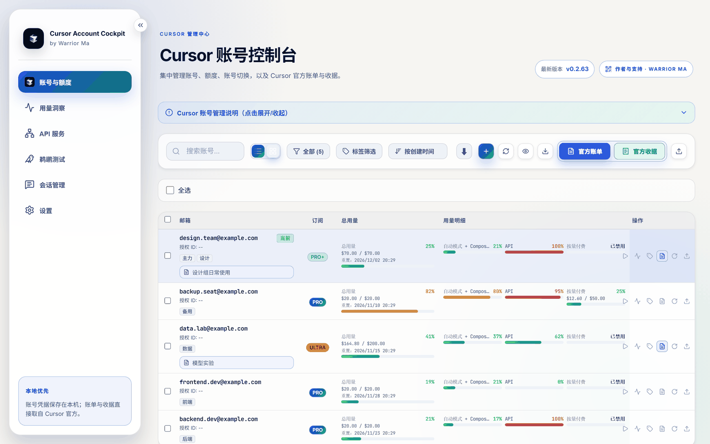
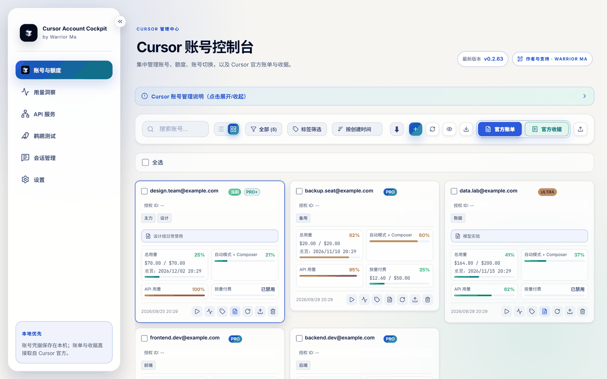
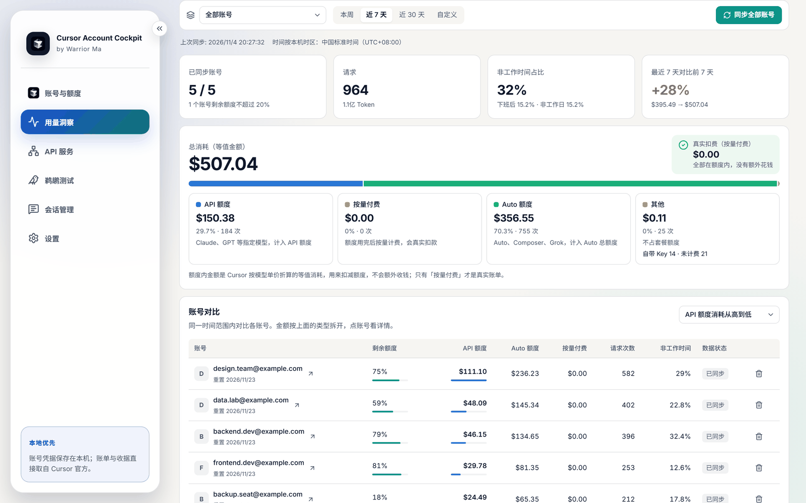
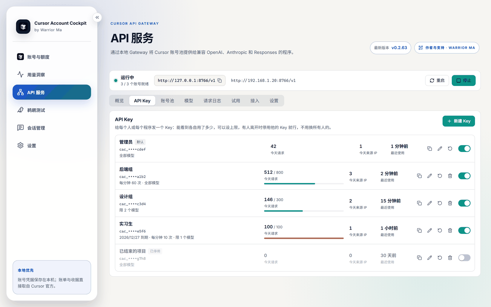
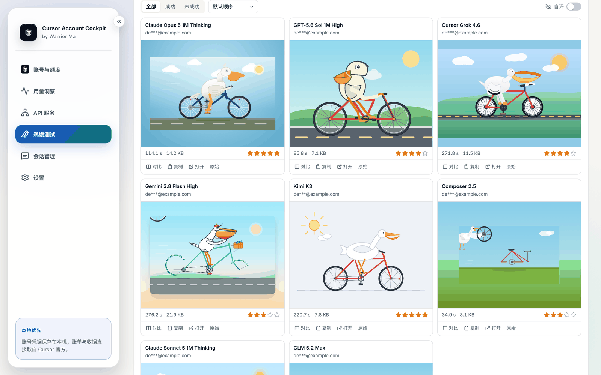

<a href="./README.md">简体中文</a> · <strong>English</strong>

<h1 align="center">Cursor Account Cockpit</h1>

Every Cursor account, clear in one window. Quota, switching, where the money goes and team keys, all managed on your own computer.

  
  
  

  <a href="https://github.com/WarriorLago/CursorAccountCockpit/releases/download/v0.2.63/Cursor-Account-Cockpit-0.2.63-x64-setup.exe"><strong>Download for Windows 0.2.63</strong></a> ·
  <a href="https://github.com/WarriorLago/CursorAccountCockpit/releases/download/v2.0.6/Cursor-Account-Cockpit-2.0.6-macos-universal.dmg"><strong>Download for macOS 2.0.6</strong></a> ·
  <a href="https://warriorlago.github.io/CursorAccountCockpit/en/">Website</a> ·
  <a href="https://warriorlago.github.io/CursorAccountCockpit/en/features.html">Features</a> ·
  <a href="./CHANGELOG.md">Changelog</a>

> This is not an official Cursor product and is not affiliated with Anysphere. Some features rely on internal Cursor endpoints, so a change at Cursor can require an update here.

## What it does

### Accounts and quota

Every account's plan, usage and reset time in one table. Switching writes the login, restarts Cursor and confirms the result, and expired accounts are stopped first. Import through OAuth, a token or the local Cursor login.

### Usage insights

Cost is split into API quota, Auto quota and real charges, then checked against Cursor's own percentages. A daily trend and time map show when usage happens, with configurable working hours and holidays. Only time, model, tokens and cost are stored, never conversations.

### Team gateway

Turn the account pool into a local API compatible with OpenAI, Anthropic and Responses. Give each person a key with daily and per-minute limits, allowed models and an expiry date, then see requests and source IPs per key. Failover is automatic, and it listens on this computer by default.

### Pelican bench

One prompt goes to many models, the results render side by side in a sandbox, and your scores feed a leaderboard. Blind mode reveals the model only after you score it, and a run can be exported as a single HTML file.

### And also

- **Official invoices and receipts**：Export official PDFs in bulk by account and month.
- **Local sessions**：Browse Agent conversations on this computer read-only, search them and export to Markdown.
- **Usage notices**：Notices for heavy off-hours use and daily spikes, off by default.
- **In-app updates**：New versions download from GitHub Releases and are verified.

## Download

| Platform | File |
| --- | --- |
| Windows 10 / 11 x64 | [Installer](https://github.com/WarriorLago/CursorAccountCockpit/releases/download/v0.2.63/Cursor-Account-Cockpit-0.2.63-x64-setup.exe) · [Portable](https://github.com/WarriorLago/CursorAccountCockpit/releases/download/v0.2.63/Cursor-Account-Cockpit-0.2.63-portable.exe) |
| macOS 11+ (Universal) | [Universal DMG (recommended)](https://github.com/WarriorLago/CursorAccountCockpit/releases/download/v2.0.6/Cursor-Account-Cockpit-2.0.6-macos-universal.dmg) · [Apple Silicon](https://github.com/WarriorLago/CursorAccountCockpit/releases/download/v2.0.6/Cursor-Account-Cockpit-2.0.6-macos-arm64.dmg) |
| macOS 10.15+ (Intel) | [Intel DMG](https://github.com/WarriorLago/CursorAccountCockpit/releases/download/v2.0.6/Cursor-Account-Cockpit-2.0.6-macos-x64.dmg) |

Other versions and checksums are on [the download page](https://warriorlago.github.io/CursorAccountCockpit/en/download.html).

On macOS, the API service and pelican bench also need Node.js 20+ and the official Cursor Agent CLI. The DMG is ad-hoc signed and not notarized, so the first launch may need approval in System Settings → Privacy & Security.

## Where your data goes

| | |
| --- | --- |
| **Account credentials** | Encrypted in the local data folder and only used to call Cursor's own services |
| **Usage records** | Only time, model, tokens and cost, never conversations, and you can clear them at any time |
| **Gateway logs** | Only key, source IP, model, status and latency, never prompts or answers |
| **Network requests** | Cursor's services, Stripe invoice files and GitHub updates. Holiday data is fetched only when you ask |
| **Data sent to the author** | None. This project has no servers of its own |

Sharing an account or routing through a gateway may not comply with Cursor's terms and can trigger risk controls, so please judge this for yourself.

## Author and license

Maintained by **Warrior Ma**. For questions or collaboration, you can [open an issue](https://github.com/WarriorLago/CursorAccountCockpit/issues), email [warriorlago@163.com](mailto:warriorlago@163.com), or find the WeChat QR code on [the website](https://warriorlago.github.io/CursorAccountCockpit/en/#author). If it helped you, you can also [support the project](./docs/SUPPORT.md).

Built on [jlcodes99/cockpit-tools](https://github.com/jlcodes99/cockpit-tools) ; see [NOTICE.md](./NOTICE.md). Licensed under [CC BY-NC-SA 4.0](./LICENSE), for non-commercial use.
