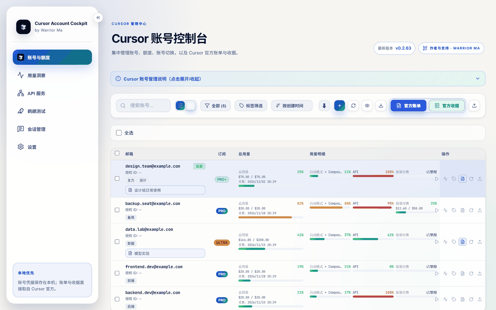
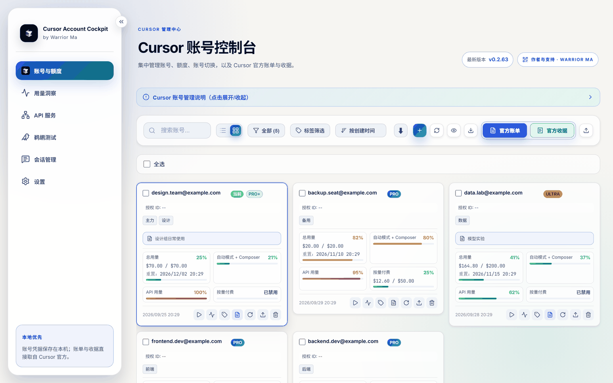
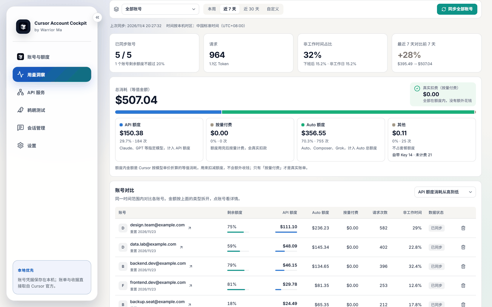
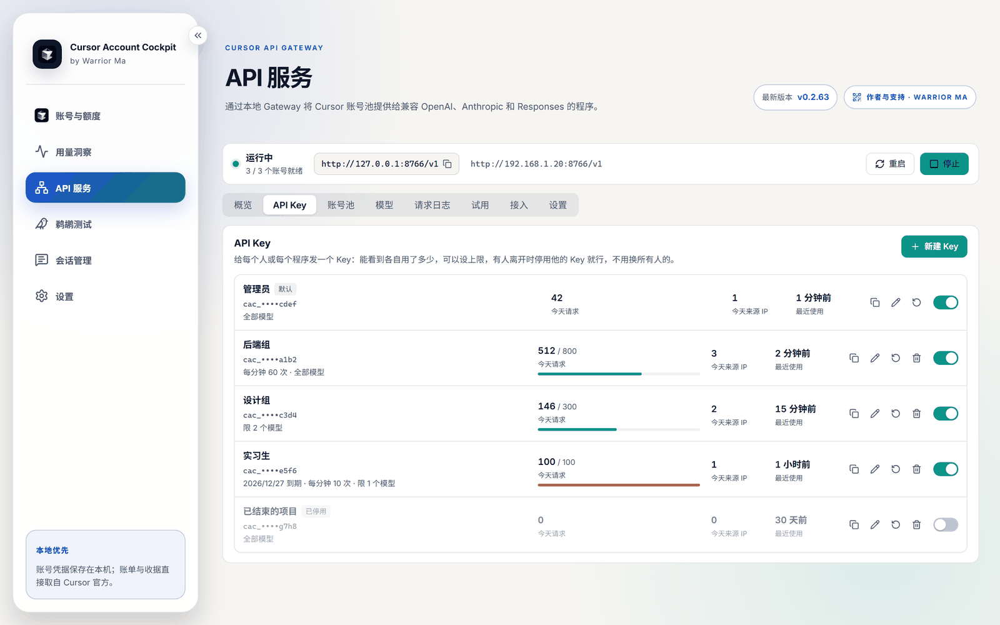

<strong>简体中文</strong> · <a href="./README.en.md">English</a>

<h1 align="center">Cursor Account Cockpit</h1>

所有 Cursor 账号，一个窗口看清楚。 额度、切号、费用去向、团队 Key，都在你自己的电脑上管理。

  
  
  

  <a href="https://github.com/WarriorLago/CursorAccountCockpit/releases/download/v0.2.68/Cursor-Account-Cockpit-0.2.68-x64-setup.exe"><strong>下载 Windows 0.2.68</strong></a> ·
  <a href="https://github.com/WarriorLago/CursorAccountCockpit/releases/download/v2.0.8/Cursor-Account-Cockpit-2.0.8-macos-universal.dmg"><strong>下载 macOS 2.0.8</strong></a> ·
  <a href="https://warriorlago.github.io/CursorAccountCockpit/">项目网站</a> ·
  <a href="https://warriorlago.github.io/CursorAccountCockpit/features.html">功能详解</a> ·
  <a href="./CHANGELOG.zh-CN.md">更新日志</a>

> 这不是 Cursor 官方产品，与 Anysphere 没有关联。部分功能用到 Cursor 的内部接口，Cursor 改动后可能需要跟着更新。

## 它能做什么

### 账号与额度

所有账号的套餐、用量和重置时间排在一张表里。一键切号会写入登录信息、重启 Cursor，再确认切换真的生效；授权失效的账号会被拦下。支持 OAuth、Token 和读取本机登录三种导入方式。

### 用量洞察

把费用拆成 API 额度、Auto 额度和真实扣费，并和 Cursor 官方的百分比自动核对。每日趋势和用量时刻表能看出什么时候用得多，工作时间、节假日和调休都可以配置。点击同步会自动刷新账号与用量，认证被拒绝时自动续期重试，无需返回账号页。只保存时间、模型、Token 和费用，不读取对话内容。

### 团队网关

把账号池变成本地 API，兼容 OpenAI、Anthropic 和 Responses 协议。给每个人发一个 Key，可设每日和每分钟限额、可用模型和到期日，并按 Key 查看请求量和来源 IP。账号出错时自动切换，默认只监听本机。连续对话复用会话，支持删除 Key、工具权限和代理设置。

### 鹈鹕测试

同一句提示词发给多个模型，在沙箱里并排渲染，打分进排行榜。盲评模式下打完分才揭晓是谁画的，也可以导出成一个 HTML 文件分享。支持换账号重试与移除单项结果。

### 还有这些

- **官方账单与收据**：按账号和月份批量导出官方 PDF。
- **本机会话**：只读浏览这台电脑上的 Agent 对话，全文搜索，导出 Markdown。
- **用量提醒**：非工作时间高消耗、当天用量激增时提醒，默认关闭。
- **应用内更新**：从 GitHub Releases 下载并校验新版本。

## 下载

| 平台 | 文件 |
| --- | --- |
| Windows 10 / 11 x64 | [安装包](https://github.com/WarriorLago/CursorAccountCockpit/releases/download/v0.2.68/Cursor-Account-Cockpit-0.2.68-x64-setup.exe) · [便携版](https://github.com/WarriorLago/CursorAccountCockpit/releases/download/v0.2.68/Cursor-Account-Cockpit-0.2.68-portable.exe) |
| macOS 11+ (通用) | [通用 DMG（推荐）](https://github.com/WarriorLago/CursorAccountCockpit/releases/download/v2.0.8/Cursor-Account-Cockpit-2.0.8-macos-universal.dmg) · [Apple Silicon](https://github.com/WarriorLago/CursorAccountCockpit/releases/download/v2.0.8/Cursor-Account-Cockpit-2.0.8-macos-arm64.dmg) |
| macOS 10.15+ (Intel) | [Intel DMG](https://github.com/WarriorLago/CursorAccountCockpit/releases/download/v2.0.8/Cursor-Account-Cockpit-2.0.8-macos-x64.dmg) |

更多版本和校验文件见 [下载页](https://warriorlago.github.io/CursorAccountCockpit/download.html)。

macOS 上的 API 服务和鹈鹕测试需要先装 Node.js 20+ 和官方 Cursor Agent CLI。DMG 使用临时签名，没有经过 Apple 公证，首次打开可能要到“系统设置 → 隐私与安全性”里允许。

## 你的数据去了哪

| | |
| --- | --- |
| **账号凭据** | 加密保存在本机数据目录，只用来请求 Cursor 官方接口 |
| **用量记录** | 只存时间、模型、Token 和费用，不存对话内容，可随时清除 |
| **网关日志** | 只记 Key、来源 IP、模型、状态和耗时，不存提示词和回答 |
| **联网请求** | Cursor 官方接口、Stripe 账单文件、GitHub 更新；节假日数据只在你点击时获取 |
| **发给作者的数据** | 没有。这个项目没有自己的服务器 |

多人共用账号或通过网关转发，可能不符合 Cursor 的使用条款，也可能触发风控，请自行评估。

## 作者与许可

由 **Warrior Ma** 维护。有问题或合作意向，可以 [提 Issue](https://github.com/WarriorLago/CursorAccountCockpit/issues)、发邮件到 [warriorlago@163.com](mailto:warriorlago@163.com)，或扫 [网站上的微信二维码](https://warriorlago.github.io/CursorAccountCockpit/#author)。如果它帮到了你，也可以 [自愿赞赏](./docs/SUPPORT.md)。

基于 [jlcodes99/cockpit-tools](https://github.com/jlcodes99/cockpit-tools) 继续开发，详见 [NOTICE.md](./NOTICE.md)。按 [CC BY-NC-SA 4.0](./LICENSE) 授权，限非商业用途。
